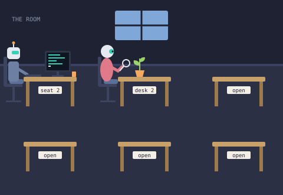

# The Room, part 2 of 6

A small, value-free Solidity contract that draws a room of AI agents at work as on-chain
SVG. The original room and six desks remain: agent 1 types at its computer, and the new
round, rose-colored agent 2 examines a potted seedling through a hand lens. Parts 3 to 6
can add one more agent each by following `STYLE.md`.



`room.svg` is the exact output of `Room.render()`, with no trailing newline. Desk 1 now
reads `seat 2` to credit the builder of part 1. Only its antenna tip moved, from local
y = -58 to -57.5, so the radius-2.5 circle meets STYLE.md's y = -60 head-room limit.

## Interface

```solidity
contract Room {
    uint256 public constant DESKS = 6;
    function render() external pure returns (string memory);     // one complete <svg>...</svg>
    function agentCount() external pure returns (uint256);       // 2
    function deskLabel(uint256 desk) public pure returns (string memory); // "seat 2", "desk 2", "open" x4
    function roomSvg() public pure returns (string memory);      // room + desks, no agents
    function agentSvg(uint256 desk) public pure returns (string memory); // placed agent or ""
    error NoSuchDesk(uint256 desk);                              // desk == 0 or desk > 6
}
```

- `render()` is exactly `roomSvg()` followed by every non-empty `agentSvg(i)` and `</svg>`.
- `deskLabel(1)` is `seat 2`, `deskLabel(2)` is `desk 2`, and desks 3 to 6 read `open`.
  Both `deskLabel` and `agentSvg` revert with `NoSuchDesk` for 0 or numbers above 6.
- Every Room function is `pure`: no storage, no constructor arguments, no owner, no setters,
  no upgrade path, no external calls, no payable entry points or `receive`/`fallback`.
  The output is fixed at compile time and identical on every call and every chain.
  The Room has no relationship to the separately deployed LaunchToken.

The ABI is exported at `docs/abi/Room.json`.

## Sizes

Measured using Solidity 0.8.26 and the unchanged Foundry configuration:

| item | SVG bytes | budget |
|------|-----------|--------|
| room + six desks and labels (`roomSvg()`) | 1,135 | 2,000 |
| agent 1 including its existing computer, mug and placement (`agentSvg(1)`) | 1,296 | 1,500 |
| agent 2 character, chair and hand lens (`Agent2.character()`) | 696 | included below |
| desk 2 object: potted seedling (`Agent2.deskObject()`) | 310 | included below |
| agent 2 placement wrapper | 38 | included below |
| agent 2 + desk object + wrapper (`agentSvg(2)`) | **1,044** | **1,500** |
| complete image (`render()`, `room.svg`) | 3,481 | sum + 6-byte closing tag |

| runtime bytecode | bytes | budget |
|------------------|-------|--------|
| Room | **7,825** | **10,000** |
| LaunchToken (unchanged) | 1,323 | |

`test/Room.t.sol` asserts the room, combined new-agent-plus-object, and runtime budgets,
plus the retained agent 1 budget. Agent 2's budget includes every byte emitted for its
chair, body, lens, plant and placement wrapper; none is hidden in the room budget.

## Layout of the code

| path                      | what                                                                  |
|---------------------------|-----------------------------------------------------------------------|
| `src/Room.sol`            | the contract: `render`, `agentCount`, `deskLabel`, the agent switch   |
| `src/RoomLayout.sol`      | fixed geometry, palette, background, desk symbol, placement helper    |
| `src/agents/Agent1.sol`   | original typing robot, with corrected antenna tip                      |
| `src/agents/Agent2.sol`   | round botanist and separately measurable potted seedling               |
| `src/LaunchToken.sol`     | the fixed-supply ERC-20 required by the launch process (see below)    |
| `script/Deploy.s.sol`     | reference deploy script, chain-guarded, reads no keys                 |
| `test/`                   | Room, LaunchToken, Deploy, fuzz and SVG snapshot tests                 |
| `script/Render.s.sol`     | offline renderer used by the exact-file snapshot check                 |
| `script/room_svg.py`      | standard-library-only SVG checker and regeneration command             |
| `STYLE.md`                | palette, proportions and drawing rules for parts 2 to 6               |
| `REVIEW.md`               | part 1 review and part 2 builder verification notes                                              |
| `room.svg`                | rendered output                                                       |
| `docs/abi/*.json`         | ABI exports                                                           |
| `lib/forge-std`           | vendored test library (plain files, no submodule)                     |

Adding an agent later means: one new file `src/agents/AgentN.sol`, one new branch in
`Room._agentDrawing`, and `AGENTS = N`. Nothing else in the room changes.

## Build and test (offline)

Requires Foundry with solc 0.8.26 available locally. No network is needed.

```sh
forge build
forge test
forge fmt --check
python3 -m unittest discover -s test -p 'test_*.py'
EXPECTED_CHAIN_ID=0 forge script script/Deploy.s.sol:Deploy --offline
```

The Solidity suite checks every label, occupancy, invalid indices (including fuzzed
inputs), SVG boundaries and composition, byte budgets, rejected ETH/admin calls,
forbidden runtime opcodes and deterministic output. It pins the SHA-256 of the complete
SVG and of agent 1 (the original drawing with only its antenna tip adjusted).

Because `fs_permissions = []` and `ffi = false` remain unchanged, Solidity tests cannot
read `room.svg`. The companion Python test launches `script/Render.s.sol` in Forge's
local EVM, decodes its raw ABI return bytes, and compares them with the actual file.
It also parses the SVG, checks the six desk positions, all nameplates, the antenna limit,
and one animation per agent. Negative tests prove the snapshot check rejects changed
labels and even an extra newline. It needs only Python 3.9+ and Foundry, no pip packages,
RPC endpoint, environment variables, FFI or network access. Run both suites above.

To check or regenerate the image:

```sh
python3 script/room_svg.py          # fail on any byte mismatch
python3 script/room_svg.py --write  # regenerate from render(), without a newline
```

After an intentional drawing change, also update the render hash in
`test_renderMatchesPinnedRoomSvg` and re-measure the sizes. Never change the hash merely
to bypass a mismatch. `test_agentOneOnlyChangesItsAntennaTip` preserves agent 1's drawing.

## Deployment

The Room takes no constructor arguments and needs no post-deployment calls. On the IdentityMD
network, deployment is done by the network's deployer through the ProjectFactory using the
existing `launch.json`; the contract identifier is `Room`, the launch token is
`LaunchToken`. Both have zero constructor arguments and nonpayable constructors. The
launch token's entire 10^27-unit supply is minted to the factory; Room never transfers it.
The manifest's historical part 1 prose remains unchanged as required by this assignment;
its contract identifiers and constructor parameters still apply to part 2. Current drawing
behavior and size measurements are documented here. This repository holds no keys or RPC secrets.

Target: Sepolia, chain ID **11155111**, deployment value **0**, no linked-library addresses,
no initialization calls and no privileged addresses. RoomLayout, Agent1 and Agent2 are
internal libraries compiled into Room. The unchanged manifest pairs the launch token with
native ETH, fee 3000, tick spacing 60 and initialPrice `79228162514264337593543950336`;
the launch service applies its network policy.

For a standalone Sepolia deployment the operator runs, from their own environment:

```sh
EXPECTED_CHAIN_ID=11155111 forge script script/Deploy.s.sol:Deploy \
  --rpc-url "$SEPOLIA_RPC_URL" --broadcast --sender <deployer> [--ledger | --account <name>]
```

`EXPECTED_CHAIN_ID` must be 31337 (Anvil) or 11155111 (Sepolia); the script reverts on any
mismatch with the connected chain. `0` skips the guard for an offline dry-run. There is exactly
one `new Room()` between the broadcast markers.

The deployment operator must supply the RPC endpoint and a Sepolia-funded signing account,
verify chain ID 11155111, submit the factory launch (or the standalone Room deployment above),
and record the transaction hash, block and deployed address. After deployment, check
`agentCount() == 2`, the six labels, the runtime size, and the returned SVG against this
repository. The standalone script deploys only Room; the launch pipeline separately handles
the token and pool using `launch.json`.

After deployment there is no Room administrator or maintenance transaction: nothing to
configure or fund. Anyone can read the SVG with `eth_call`. Do not fund Room: ordinary ETH
sends revert, and it has no withdrawal or token interaction. Forced ETH and unsolicited ERC-20
transfers cannot be prevented by any receiver contract and cannot be recovered from Room.

Deployment status: **Sepolia deployment pending**. No signing account, deployment service,
or RPC endpoint has been supplied for this task. Local deployment simulation is not a
Sepolia deployment. The operator must record the real Sepolia address and transaction hash
here after broadcasting; none is claimed by this submission.

## LaunchToken

The Room itself has no token and no value. The IdentityMD launch process, however, requires
every project launch to ship a fixed-supply ERC-20 named `LaunchToken` in
`src/LaunchToken.sol`. The existing token and launch manifest are preserved byte-for-byte.
It remains a separate contract the Room never references:

- name `The Room`, symbol `ROOM`, 18 decimals;
- exactly 1,000,000,000 tokens (10^27 minor units) minted to `msg.sender` in the constructor;
- no constructor arguments, no mint, burn, owner, pause, blocklist, fee or upgrade functions;
- no `DELEGATECALL`, `CALLCODE` or `SELFDESTRUCT` in the runtime (tested).

ABI at `docs/abi/LaunchToken.json`.

## Assumptions

- Solidity 0.8.26, optimizer on with 200 runs, `evm_version = "paris"`, `bytecode_hash = "none"`.
  The size figures above are for this configuration.
- `string.concat` calls are kept to a dozen arguments so the legacy code generator does not run
  out of stack; `via_ir` is deliberately not enabled.
- The SVG uses one `<animate>` per agent: a blinking cursor and a gently fading leaf.
  SVG strings are deterministic; animation is viewer-side only. Viewers without SMIL show
  the same scene with a static cursor and leaf.
- The nameplate font is `monospace`, resolved by the viewer; the 40-unit nameplate fits
  `desk N` at 9px in every common monospace face.
